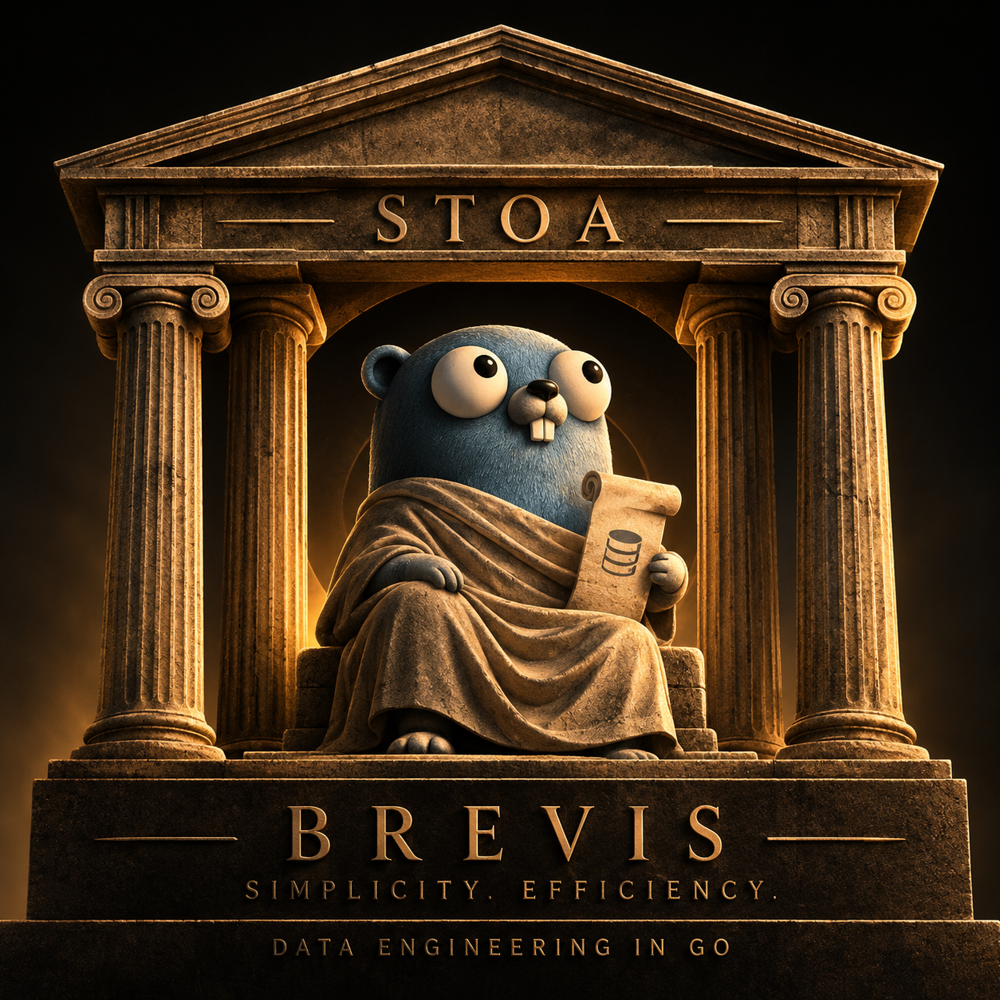

<p align="center">
  
</p>

<h1 align="center">stoa</h1>

<p align="center">
  <strong>A data lake that is 100% Go.</strong><br>
  Brevis, Apache Iceberg and DuckDB, from ingest to API — no JVM, no Spark,
  not one binary that is not Go, and no Kubernetes to get started.<br>
  <code>make up</code> and <code>make demo</code>, on one machine.
</p>

---

## What runs today

```sh
make up      # SeaweedFS (the S3), Postgres (catalog and engine), Brevis with its console, the gateway, Redis and the metrics API
make seed    # 100,000 events in five POSTs to the gateway, which answers 202 and leaves NDJSON in the landing on S3
make run     # triggers a run of the `lake` workflow: the scheduler runs `land`, then `metrics`
make read    # DuckDB reads bronze.events and gold.daily_revenue by their metadata.json
make api     # GET /v1/metrics/daily_revenue twice: the first computes in DuckDB, the second comes from Redis
```

The console is at `http://localhost:8080`, user `stoa`, with the password
`make up` prints and keeps in `.env.local`, which is never committed. The run
shows up there with its steps, their phases and their numbers; `make logs`
follows the scheduler. `make land` and `make metrics` run the same steps by
hand, outside the engine.

## Why "stoa"

The **Stoa Poikile** — the Painted Porch — stood on the north side of the
Athenian Agora: a covered colonnade, open along one side, hung with paintings
of battles. It was not a school. It was a public walkway, and anyone crossing
the market could step under its roof.

Around 300 BC a merchant from Citium named **Zeno** began teaching there. The
story Diogenes Laërtius tells is that he reached Athens by shipwreck, lost a
cargo of purple dye, wandered into a bookshop, read about Socrates and asked
where men like that were to be found. He never built an academy. He taught in
the porch, and his students were called **Stoics** after the building rather
than after him.

What they taught: *aretē* (ἀρετή) — excellence, a thing working fully as the
thing it is — is the only real good. Everything else is indifferent. Attend to
what is yours to decide and let the rest be what it is. Three centuries later
Seneca wrote *De Brevitate Vitae*, "On the Shortness of Life", and his
argument was not that life is short. It is that we spend it on what has not
earned the time.

That is the whole reason this repository carries this name.

- **Arete Academy** publishes Brevis. *Aretē* is the Stoic's single good.
- **Brevis** is Latin for *brief*, and the first word of Seneca's title. One
  binary, no JVM, nothing in the stack that has not earned its place.
- **stoa** is the porch: public, entered from the street, and what you learn
  here you learn by watching the thing run.

The "not doing" list below is a Stoic discipline before it is an engineering
one.

## How a record travels

The gateway is the published `brevissh/brevis-gateway` with one route,
`POST /v1/events`, and a stream configured in `deploy/gateway/gateway.yaml`:
NDJSON, identity over `event_id` and `occurred_at`, `ingestion_id` and
`ingestion_loaded_at` stamped on acceptance, and one object in the landing
every 20,000 events or two seconds. The console shows it under `/data` and
`/ingest/streams` because `make up` publishes its description, the way it
publishes a workflow. Locally the door stays open, with no token, and the
gateway says so in its log; outside `BREVIS_ENV=local` it refuses to start
without `listen.auth`.

`land` is the workflow's first step. It uses Brevis's Iceberg destination,
[`brevis.sh/brevis/sdk/iceberg`](https://github.com/brevis-sh/brevis/tree/master/sdk/iceberg):
it reads the landing with `from.Files`, already carrying the two columns the
gateway wrote, and writes with `iceberg.Table`, which creates the table from
the declaration on the first run — format v2, zstd Parquet, partitioned by
`day(occurred_at)`. Each `FlushEvery` batch is one write and one snapshot.
DuckDB reads the result with no catalog at all, by the `metadata.json` path
the SQL catalog keeps in Postgres: that is how Spark and Trino would find the
table too.

### The gold is Iceberg too, and the API reads the lake

`metrics` is the sentence worth a post on its own: **DuckDB computes, and
iceberg-go commits.** It asks the catalog for the current `metadata.json` of
`bronze.events`, aggregates revenue and volume per day and per host in DuckDB,
and writes the result as a new version of `gold.daily_revenue` through the
same `iceberg.Table` that `land` uses. Brevis's Iceberg destination only
appends, so every run writes a version stamped with `computed_at` and whoever
reads takes the most recent one: the gold has history too. No cgo anywhere —
DuckDB is the pinned CLI, called as a process, and the scheduler's image is
Brevis's published worker plus the `libstdc++` that CLI asks for.

The API at `http://localhost:8082/v1/metrics/daily_revenue?from=&to=` reads
the latest version of the gold through DuckDB, and the Redis cache is keyed on
the **snapshot id of the gold table**: while the lake does not move, the
answer comes from Redis; when `metrics` writes a new snapshot, the key changes
on its own. Iceberg already knows when it changed, and no TTL has to guess.
The `X-Lake-Snapshot`, `X-Cache` and `Server-Timing` headers tell the story of
each response.

**Postgres is only the metastore**: the Iceberg catalog and the engine's own
database. No lake data lives in it.

## What comes up

| piece | what it is | where it comes from |
|---|---|---|
| SeaweedFS | the lake's S3, a single Go binary | official image, `chrislusf/seaweedfs:4.52` |
| Postgres | two databases: `lake`, the Iceberg catalog, and `brevis`, the engine | official image, `postgres:17-alpine` |
| Brevis | the engine: queue, scheduler, console; steps run as processes inside the scheduler's container | published images, `brevissh/brevis:0.41.0` and `:0.41.0-worker` |
| brevis-gateway | `POST /v1/events`, a 202, NDJSON in the landing on S3; described and published to the console by `make up` | published image, `brevissh/brevis-gateway:0.33.0`, config in `deploy/gateway/gateway.yaml` |
| Redis | the API's cache, keyed on the gold's snapshot | official image, `redis:7-alpine` |
| DuckDB | the engine behind the metrics, and the reader that is not the writer | CLI pinned at 2.0.0, fetched by `scripts/duckdb.sh` for the host and, as a musl build, for the containers' Linux |
| `workflows/lake.yaml` | the workflow with the `land` and `metrics` steps, published to the `stoa` project | this repository |
| `seed` | a producer: invented events, sent to the gateway in NDJSON batches | this repository, `cmd/seed` |
| `land` | the landing into the Iceberg table, an `sdk.Pipeline` | this repository, `cmd/land`, built into `bin/` by `make build` |
| `metrics` | DuckDB aggregates the bronze and iceberg-go writes `gold.daily_revenue` | this repository, `cmd/metrics`; the scheduler runs an image derived from the worker with `libstdc++` (`deploy/scheduler`) |
| `api` | `GET /v1/metrics/daily_revenue`: the gold through DuckDB, cached per snapshot | this repository, `cmd/api`, on an Alpine with the CLI's `libstdc++` (`deploy/runtime`) |

Configuration comes from the environment, with the defaults in
`docker-compose.yml`: `STOA_S3_ENDPOINT`, `STOA_S3_KEY`, `STOA_S3_SECRET`,
`STOA_S3_REGION`, `STOA_BUCKET`, `STOA_PG_DSN`.

## The ladder

Each episode of the series removes a piece of glue from this repository,
because that piece became product.

| episode | what arrives | what stops being glue |
|---|---|---|
| 1 | the lake comes up; `land` writes, DuckDB reads **(done)** | `land` itself: twenty lines over `sdk/iceberg`, not two hundred over iceberg-go |
| 2 | the gateway takes `POST /v1/events` and leaves the landing on S3 **(done)** | the `seed` that used to write to S3; it is a producer now |
| 3 | `metrics`: DuckDB over `iceberg_scan`, gold **in Iceberg** through `sdk.Load`; an API reads the gold with a cache keyed per snapshot **(done)** | nothing yet: DuckDB as a process and this API are glue until brevis-sql learns the DuckDB dialect |
| 4 | the gateway writes straight to Iceberg through an `iceberg` sink | the NDJSON landing and `land` |
| 5 | brevis-sql models over the lake and brevis-sql-api serves it, with the snapshot as the generation | this repository's API and DuckDB as a process |

## Not doing, and why

- **No Kubernetes to start.** The point is that a data team sees the whole
  thing work on one machine before deciding anything.
- **No JVM.** Not in the S3, not in the catalog, not in the query engine. It
  is the claim this repository exists to make.
- **No type inference.** Every table here is declared with its types. A
  `NUMERIC(18,2)` guessed from a JSON number is the one thing this stack
  refuses to do.
- **No deduplication at write time.** The Iceberg destination appends; a
  retried batch lands once through its `BatchKey`, which travels in the
  snapshot's summary.

## Status, honestly

The `go.mod` carries a **temporary** `replace` of
`brevis.sh/brevis/sdk/iceberg` to a neighbouring checkout of Brevis: the
Iceberg destination is in
[brevis-sh/brevis#230](https://github.com/brevis-sh/brevis/pull/230), and Go
only resolves that path once the site serves its `go-import` page, which is
generated from master. When the PR lands and the `sdk/iceberg/v0.1.0` tag
exists, the `replace` goes away and stoa builds on its own anywhere.

The workflow has no `schedule` yet: `land` re-reads the whole landing on every
run, and two runs over the same landing would double the table. One run per
seed, until the landing is partitioned by hour and the step reads only what
has not landed.

The console's `/data` does not show `iceberg://lake/bronze/events` yet. The
scheme arrived in
[brevis-sh/brevis#229](https://github.com/brevis-sh/brevis/pull/229) after the
published engine was cut, so 0.41.0 does not know it: the step declares the
landing and the scheduler records "a step declared landings the engine did not
keep, refused=1" in its log. Raising the tag in `docker-compose.yml` is all it
takes, once a release carries it.

Each run of `land` writes 140 Parquet files, not five: the table is
partitioned by `day(occurred_at)` and the events span 28 days, so each of the
five batches becomes one file per day. That is the layout that makes
"yesterday's events" a read of one directory, and it is what a
partition-aware reader expects to find.

## License

MIT, like Brevis.
